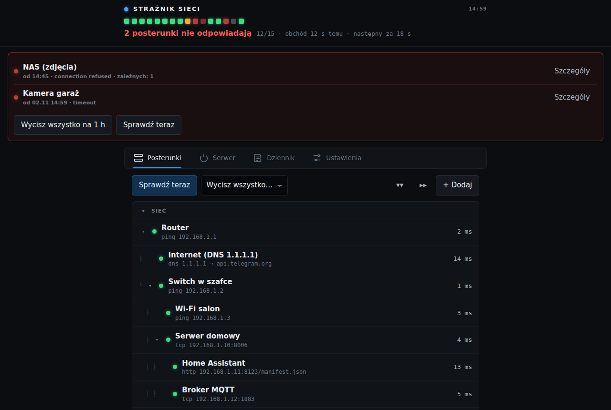
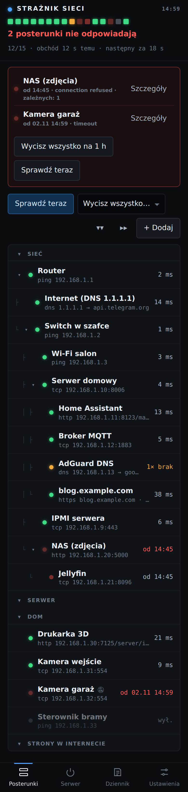
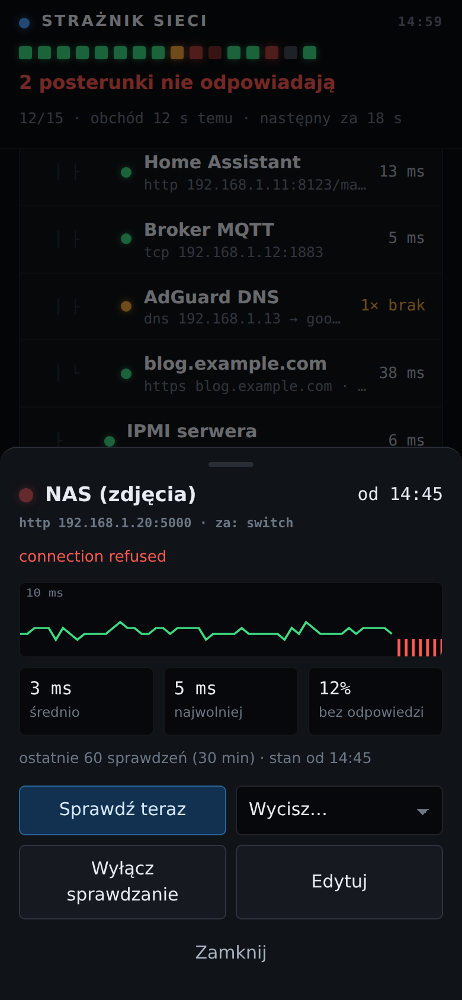
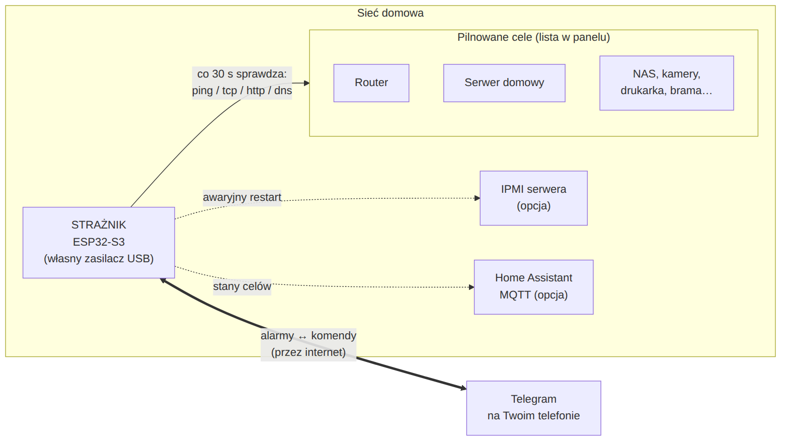

# Strażnik sieci

Mały, niezależny strażnik domowej sieci na płytce **ESP32-S3**. Co 30 sekund sprawdza
router, serwer, usługi i urządzenia w sieci domowej. Gdy coś przestaje odpowiadać, wysyła
wiadomość na **Telegram**.

**Po co osobne urządzenie?** Zwykle alarmy wysyła Home Assistant albo inny program na
domowym serwerze. Kiedy padnie sam serwer, alarmy padają razem z nim i nikt się o tym nie
dowie. Strażnik to osobna płytka za kilkadziesiąt złotych z własnym zasilaczem, więc
działa dalej, gdy serwer leży.

  
  

*Zrzuty pokazują przykładowe dane, a nie prawdziwą sieć.*

## Co potrafi

- **Cztery rodzaje sprawdzania:** `ping` (czy urządzenie żyje), `tcp` (czy usługa słucha
  na porcie), `http`/`https` (czy strona odpowiada właściwym kodem, a przy https także,
  czy certyfikat nie wygasa) i `dns` (czy serwer DNS rozwiązuje nazwy).
- **Mniej fałszywych alarmów:** awaria to dopiero 3 porażki z rzędu (około 1,5 minuty).
- **Zależności:** gdy padnie serwer, przychodzi **jedna** wiadomość „Serwer nie odpowiada,
  zależnych od niego: 8”, a nie osobna wiadomość o każdej usłudze na nim.
- **Telegram:** alarmy, przypomnienia „nadal nie działa”, przyciski wyciszania pod
  alarmem, komendy (`/status`, `/problemy`, `/wycisz`…). Gdy nie ma internetu,
  wiadomości czekają w kolejce i wychodzą później z godziną zdarzenia.
- **Panel WWW** pod `http://straznik.local`: drzewko celów, wykresy czasu odpowiedzi,
  dodawanie celów formularzem, dziennik zdarzeń i ustawienia. Działa na telefonie
  i na komputerze.
- **Home Assistant (opcja):** każdy cel jako czujnik przez MQTT.
- **Awaryjny restart serwera przez IPMI (opcja):** gdy serwer się zawiesi, strażnik pyta
  na Telegramie, czy zrobić twardy reset, i robi go po potwierdzeniu.
- **Samoobrona:** sprzętowy watchdog (restart zawieszonego programu), własne serwery DNS,
  codzienna wiadomość „żyję” i awaryjna sieć Wi-Fi do konfiguracji, gdy płytka nie może
  połączyć się z Twoją siecią.

## Instrukcje krok po kroku

Czytaj po kolei. Rozdziały 4 i 5 są opcjonalne.

| # | Rozdział | O czym |
|---|---|---|
| 1 | [Części](docs/01-czesci.md) | co kupić, ile to kosztuje |
| 2 | [Instalacja](docs/02-instalacja.md) | program na komputer, hasła, wgranie na płytkę, pierwsze uruchomienie |
| 3 | [Konfiguracja](docs/03-konfiguracja.md) | Wi-Fi, bot Telegram, lista pilnowanych urządzeń, ustawienia |
| 4 | [Home Assistant](docs/04-home-assistant.md) | czujniki w HA przez MQTT (opcja) |
| 5 | [Restart serwera przez IPMI](docs/05-restart-serwera-ipmi.md) | awaryjny reset zawieszonego serwera (opcja, dla zaawansowanych) |
| 6 | [Codzienne używanie](docs/06-codzienne-uzywanie.md) | komendy Telegrama, dioda, wyciszanie, aktualizacje |
| 7 | [Gdy coś nie działa](docs/07-problemy.md) | typowe problemy i rozwiązania |
| 8 | [Jak to działa w środku](docs/08-jak-to-dziala.md) | budowa programu, decyzje projektowe |

**Najkrótsza droga:** kup płytkę (rozdział 1), wgraj program (rozdział 2), załóż bota
i wpisz swoje urządzenia (rozdział 3). Zajmuje to około godziny, jeśli robisz to
pierwszy raz.

## Struktura repozytorium

| Ścieżka | Co zawiera |
|---|---|
| `firmware/` | program na płytkę (PlatformIO, Arduino-ESP32) i skrypt `build.sh` |
| `firmware/src/secrets.h.example` | wzór pliku z hasłami; kopiujesz go do `secrets.h` |
| `docs/` | instrukcje, w `docs/img/` zrzuty i schematy |
| `tools/panel_demo.py` | podgląd panelu w przeglądarce bez płytki, na przykładowych danych |
| `tools/panel_screenshots.py` | odświeża zrzuty w `docs/img/` |
| `tools/ipmi_proto.py` | test połączenia IPMI z komputera (rozdział 5) |
| `tools/decode_crash.sh` | tłumaczy adresy z raportu awarii programu na linie kodu |

## Stan projektu

Działa na co dzień w jednym domu od września 2026 (około 60 pilnowanych celów, Wi-Fi).
Planowane, ale jeszcze niezrobione: Ethernet z zasilaniem PoE i zapasowe SMS-y przez
moduł GSM.
