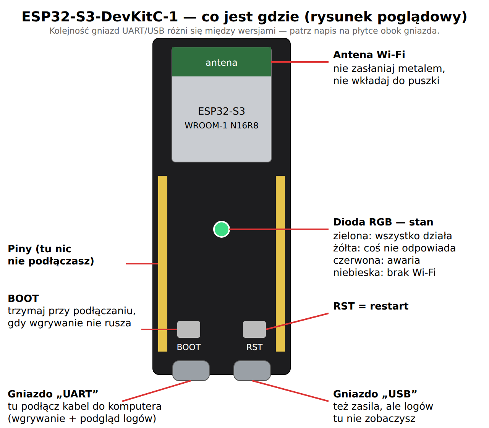

# 1. Części

Do wersji podstawowej wystarczą trzy rzeczy. **Nic nie lutujesz**: płytka dostaje prąd
i program jednym kablem USB.

| # | Część | Po co | Orientacyjna cena |
|---|---|---|---|
| 1 | **ESP32-S3-DevKitC-1 N16R8** (16 MB flash, 8 MB PSRAM) | mózg: Wi-Fi, szyfrowane połączenie z Telegramem | 35–60 zł |
| 2 | **Kabel USB-C z przesyłem danych** | wgranie programu z komputera | zwykle masz |
| 3 | **Ładowarka USB 5 V, min. 1 A** | stałe zasilanie strażnika | zwykle masz |

## Na co uważać przy zakupie

- **Szukaj dokładnie „ESP32-S3-DevKitC-1” i „N16R8”.** Program jest ustawiony pod 16 MB
  pamięci flash i 8 MB pamięci PSRAM. Inna wersja (np. N8R2) też może zadziałać, ale
  wymaga zmiany ustawień w `firmware/platformio.ini` (rozdział 7).
- **Płytka powinna mieć dwa gniazda USB-C** z napisami „UART” i „USB”. Tak wygląda
  oryginalna płytka Espressif i jej wierne kopie.
- **Kabel musi przesyłać dane.** Wiele tanich kabli od ładowarek ma tylko przewody
  zasilające: płytka świeci, ale komputer jej nie widzi. Jeśli komputer nie reaguje na
  podłączenie, najpierw wymień kabel.
- **ESP8266 (np. Wemos D1 mini) się nie nada.** Ma za mało pamięci na szyfrowane
  połączenie z Telegramem i będzie się zawieszał.

## Gdzie postawić strażnika

- **Na innym zasilaniu niż serwer**, jeśli to możliwe. Gdy serwer i strażnik wiszą na
  jednej listwie, wyłączenie listwy wyłączy oba i nikt nie dostanie alarmu. Sensowne
  miejsce to gniazdko za UPS-em routera albo zwykłe gniazdko w innym pokoju.
- **W zasięgu dobrego Wi-Fi 2,4 GHz.** ESP32 nie widzi sieci 5 GHz. Dobry sygnał to
  powyżej −70 dBm; strażnik pokazuje go w panelu (Ustawienia → System).
- **Antena wolna:** nie wkładaj płytki do metalowej puszki ani za metalową obudowę.
- Dowolna mała obudowa z otworem na kabel wystarczy. Dioda na płytce pokazuje stan, więc
  dobrze, gdy jest widoczna (przezroczysta obudowa albo otwór).

## Plan na przyszłość (jeszcze nie w programie)

Te części nie są potrzebne teraz; program ich jeszcze nie obsługuje.

| Część | Po co |
|---|---|
| Moduł Ethernet W5500 + rozdzielacz PoE 5 V | strażnik na kablu, zasilany ze switcha PoE |
| Moduł GSM (SIM800L albo LTE A7670E) + ogniwo Li-Ion | SMS, gdy padnie internet i prąd |
