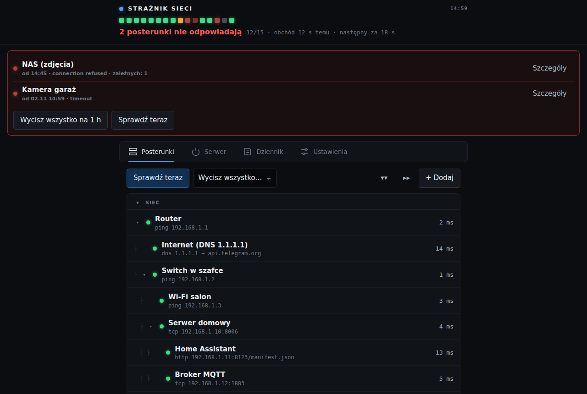

# 2. Instalacja

Na końcu tego rozdziału strażnik będzie wgrany na płytkę, połączony z Twoim Wi-Fi,
a panel będzie się otwierał w przeglądarce. Telegram i lista urządzeń są w rozdziale 3.

Czas: około 30–45 minut za pierwszym razem, głównie na instalację programów.

## Krok 1. Zainstaluj programy na komputerze

Program na płytkę budujesz sam, bo w środku są Twoje hasła. Potrzebujesz:

1. **Visual Studio Code**: https://code.visualstudio.com (Windows, macOS, Linux).
2. W VS Code: ikona kwadracików po lewej (Extensions) → wpisz **PlatformIO IDE** →
   **Install**. Po instalacji uruchom VS Code ponownie. PlatformIO przy pierwszym
   uruchomieniu sam pobiera narzędzia; to trwa kilka minut i widać postęp w prawym
   dolnym rogu.
3. **Pobierz to repozytorium.** Na stronie repozytorium na GitHubie: zielony przycisk
   **Code** → **Download ZIP**, a potem rozpakuj. Jeśli używasz gita:
   `git clone <adres repozytorium>`.

> **Linux, bez VS Code:** wystarczy `pip install platformio`. Dalej używasz komend
> `pio …` z katalogu `firmware/`.

## Krok 2. Wpisz hasła

1. W VS Code: **File → Open Folder** i wybierz katalog **`firmware`** z repozytorium (nie
   katalog główny). PlatformIO rozpozna projekt po pliku `platformio.ini`.
2. W katalogu `src/` skopiuj plik `secrets.h.example` i nazwij kopię **`secrets.h`**.
   (Prawy klik → Copy, prawy klik na `src` → Paste, potem F2 i zmiana nazwy.)
3. Otwórz `secrets.h` i uzupełnij przynajmniej dwie wartości:

   ```c
   #define PANEL_PASS         "tu-wymysl-haslo-do-panelu"
   #define SETUP_AP_PASS      "haslo-sieci-awaryjnej"   // min. 8 znaków
   ```

   - `PANEL_PASS` to hasło do panelu WWW. Login zawsze brzmi `admin`.
   - `SETUP_AP_PASS` to hasło awaryjnej sieci Wi-Fi „Straznik-Setup”. Strażnik ją
     wystawia, gdy nie może połączyć się z Twoim Wi-Fi.

   **Bez tych dwóch haseł program się nie zbuduje** i pokaże błąd
   `wpisz PANEL_PASS`. To celowe, bo panel bez hasła byłby otwarty dla każdego w sieci.

4. **Opcjonalnie** wpisz od razu swoje Wi-Fi, żeby ominąć krok 6:

   ```c
   #define DEFAULT_WIFI_SSID  "NazwaTwojejSieci"
   #define DEFAULT_WIFI_PASS  "hasloDoWiFi"
   ```

   Sieć musi działać w paśmie **2,4 GHz**. Resztę (Telegram, MQTT, IPMI) łatwiej ustawić
   potem w panelu.

> **Plik `secrets.h` nigdy nie trafia do repozytorium** (blokuje go `.gitignore`). Gotowe
> pliki `.bin` też zawierają te hasła, więc nie wysyłaj ich nikomu.

### Strefa czasowa

Strażnik podaje godziny według czasu polskiego. Jeśli mieszkasz gdzie indziej, zmień
`TZ_INFO` w `src/config.h` (lista wartości: wyszukaj „posix timezone string” i nazwę
swojego miasta).

## Krok 3. Podłącz płytkę

1. Podłącz płytkę kablem USB-C do komputera, do gniazda z napisem **UART**. Przez to
   gniazdo widać też komunikaty programu.
2. Na płytce zaświeci czerwona dioda zasilania.
3. Sprawdź, czy komputer ją widzi:
   - **Windows:** Menedżer urządzeń → „Porty (COM i LPT)” → pojawia się nowy port COM.
     Jeśli zamiast tego widać „nieznane urządzenie”, zainstaluj sterownik układu USB
     z płytki: **CH343** (producent WCH) albo **CP210x** (Silicon Labs), zależnie od tego,
     co jest napisane na małym układzie przy gnieździe.
   - **macOS:** w Terminalu `ls /dev/cu.*` pokazuje nowe urządzenie `usbmodem…` albo
     `wchusbserial…`.
   - **Linux:** `ls /dev/ttyACM* /dev/ttyUSB*`. Jeśli brak uprawnień, dodaj się do grupy
     `dialout` (`sudo usermod -aG dialout $USER`) i zaloguj ponownie.

## Krok 4. Zbuduj i wgraj program

W VS Code na dolnym pasku są ikony PlatformIO:

| Ikona | Co robi |
|---|---|
| ✓ (Build) | tylko buduje |
| → (Upload) | buduje i wgrywa na płytkę |
| 🔌 (Serial Monitor) | pokazuje komunikaty płytki |

1. Kliknij **→ Upload**. Pierwsze budowanie trwa 2–5 minut, bo PlatformIO pobiera
   biblioteki. Kolejne idą w kilkanaście sekund.
2. Na końcu powinno być widać `SUCCESS`.
3. **Jeśli wgrywanie stoi na `Connecting....`:** przytrzymaj przycisk **BOOT** na płytce,
   wciśnij i puść **RST**, puść BOOT. Potem kliknij Upload jeszcze raz.

Z wiersza poleceń (Linux/macOS) to samo robi:

```bash
cd firmware
pio run -t upload          # zbuduj i wgraj
pio device monitor         # podgląd komunikatów (wyjście: Ctrl+C)
```

## Krok 5. Sprawdź, czy wystartował

Kliknij **🔌 Serial Monitor** (albo `pio device monitor`). Po wciśnięciu RST na płytce
zobaczysz mniej więcej:

```
=== Straznik sieci 0.9.4 ===
...
Wi-Fi połączone, IP 192.168.1.50
```

Jeśli wpisałeś Wi-Fi w `secrets.h`, zapisz **adres IP** z tego komunikatu i przejdź do
kroku 7. Jeśli nie, przejdź do kroku 6.

> Otwarcie podglądu komunikatów restartuje płytkę. To normalne przy tym typie płytki.

## Krok 6. Ustaw Wi-Fi przez sieć awaryjną

Wykonaj ten krok tylko wtedy, gdy nie wpisałeś Wi-Fi w `secrets.h` albo strażnik nie
może się z nim połączyć.

1. Odczekaj **minutę** od włączenia. Strażnik wystawi wtedy własną sieć Wi-Fi
   **Straznik-Setup**.
2. Połącz z nią telefon albo laptop. Hasło to `SETUP_AP_PASS` z kroku 2. Telefon może
   ostrzec „brak internetu”; zostań w tej sieci.
3. Otwórz w przeglądarce **http://192.168.4.1**. Login: `admin`, hasło: `PANEL_PASS`.
4. **Ustawienia → Wi-Fi** → wpisz nazwę i hasło swojej sieci → **Zapisz**.
5. Strażnik się zrestartuje i połączy z Twoją siecią. Sieć Straznik-Setup zniknie.

## Krok 7. Otwórz panel

1. W przeglądarce na komputerze albo telefonie w Twojej sieci domowej wpisz
   **http://straznik.local**.
2. Jeśli strona się nie otwiera, wpisz adres IP z kroku 5, np. `http://192.168.1.50`.
   Adres znajdziesz też w panelu routera, na liście podłączonych urządzeń, pod nazwą
   `straznik`. (Niektóre telefony z Androidem nie obsługują nazw `.local`.)
3. Login `admin`, hasło `PANEL_PASS`.

Powinieneś zobaczyć panel z przykładową listą kilku celów (router, internet, serwer,
Home Assistant). Adresy na tej liście są przykładowe; wymienisz je w rozdziale 3.



## Krok 8. Zarezerwuj stały adres IP (zalecane)

W panelu routera ustaw **rezerwację DHCP** (w niektórych routerach „stały adres”,
„static lease”) dla strażnika. Jego adres MAC widać w panelu w zakładce Ustawienia →
System. Dzięki temu adres nie zmieni się po restarcie routera.

## Krok 9. Przenieś strażnika na docelowe miejsce

Odłącz płytkę od komputera i podłącz ją do zwykłej ładowarki USB w docelowym miejscu
(rozdział 1, „Gdzie postawić strażnika”). Ustawienia zostają w pamięci płytki. Kolejne
aktualizacje wgrasz przez sieć, bez kabla (rozdział 6).

**Dalej:** [rozdział 3, konfiguracja](03-konfiguracja.md).
