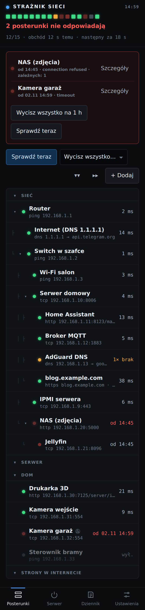
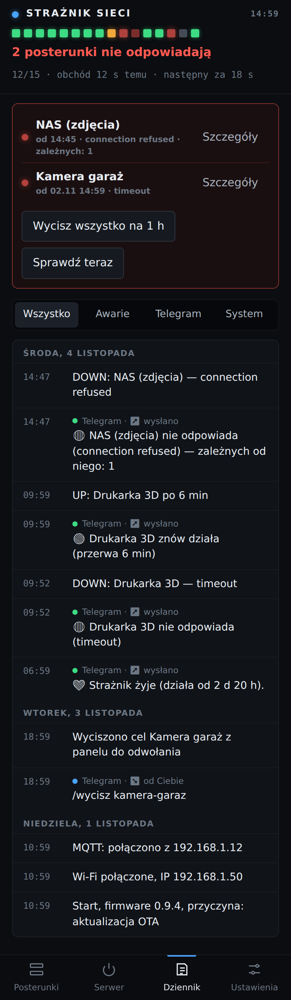
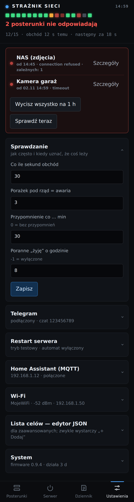
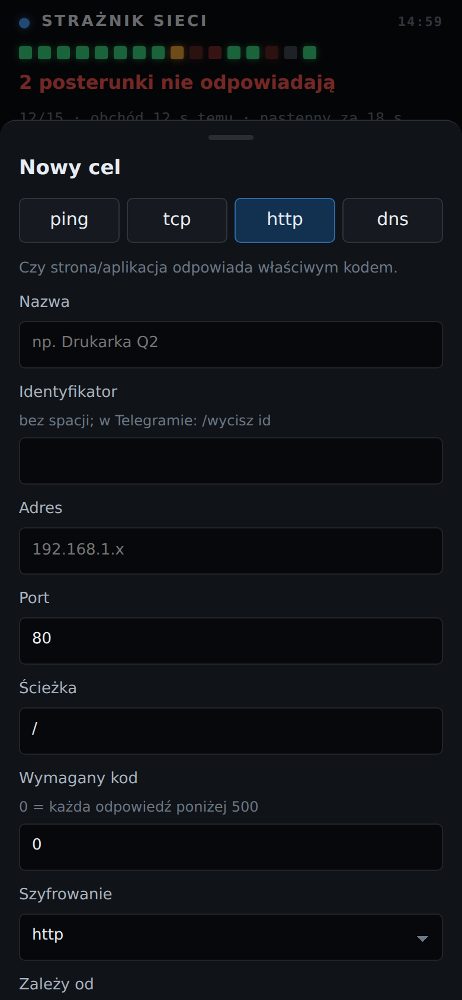
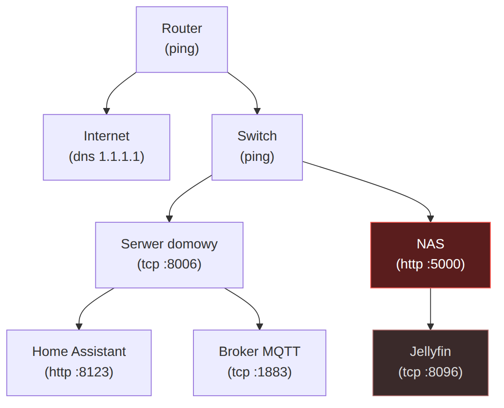

# 3. Konfiguracja

Zakładam, że panel już się otwiera (rozdział 2). Wszystko poniżej ustawiasz w panelu
`http://straznik.local` i zapisuje się to w pamięci płytki, więc przeżywa restart
i aktualizację.

Kolejność: najpierw Telegram (bez niego alarmy trafiają tylko do dziennika w panelu),
potem lista urządzeń.

## Panel w skrócie

Panel ma cztery zakładki:

| Zakładka | Co tam jest |
|---|---|
| **Posterunki** | listwa diod (jedna na cel), drzewko celów, czerwona ramka z tym, co leży, przycisk „+ Dodaj” |
| **Serwer** | stan zasilania serwera i przyciski restartu przez IPMI (tylko gdy ustawisz rozdział 5) |
| **Dziennik** | zdarzenia (awarie, powroty, zmiany ustawień) i historia wiadomości Telegram |
| **Ustawienia** | Sprawdzanie, Telegram, Restart serwera, Home Assistant, Wi-Fi, edytor listy celów, System |

<p align="center">
  
  
  
</p>

Kliknięcie celu na liście otwiera jego **kartę**: wykres czasu odpowiedzi z ostatnich
60 sprawdzeń, błąd, przyciski „Sprawdź teraz”, „Wycisz…”, „Wyłącz sprawdzanie”
i „Edytuj”.

## Telegram

Strażnik pisze przez własnego bota. Bot to osobne konto w Telegramie, które należy do
Ciebie; zakładasz go w minutę.

### Krok 1. Załóż bota

1. W Telegramie znajdź **@BotFather** (z niebieskim znaczkiem weryfikacji) i napisz
   `/newbot`.
2. Podaj nazwę, np. `Strażnik sieci`.
3. Podaj nazwę użytkownika bota. Musi kończyć się na `bot`, np. `moj_straznik_bot`.
4. BotFather odpisze **token**, długi napis w stylu `1234567890:AAH…`. Skopiuj go.
   **Token to hasło do bota**, nie pokazuj go nikomu.

### Krok 2. Wpisz token w panelu

1. Panel → **Ustawienia → Telegram** → pole **Token bota** → wklej → **Zapisz**.

### Krok 3. Połącz bota ze swoim czatem

1. W Telegramie otwórz swojego nowego bota (link `t.me/<nazwa_bota>` od BotFathera)
   i napisz cokolwiek, np. `/start`.
2. W ciągu kilkunastu sekund w panelu pojawi się żółty pasek
   **„Do bota napisał czat …”** z przyciskiem **To mój czat — użyj**. Kliknij go.
3. Bot przywita się wiadomością.

Od tej chwili bot **słucha tylko Twojego czatu**. Wiadomości od innych osób ignoruje,
a przyciski pod alarmami działają tylko w Twoim czacie.

### Krok 4. Sprawdź

Napisz do bota `/test`. Powinien odpisać „✅ Test: Strażnik odpowiada…”. Wszystkie
komendy opisuje rozdział 6.

> **Strażnik na grupie zamiast w prywatnym czacie:** dodaj bota do grupy, napisz tam
> `/start` i kliknij „To mój czat” tak samo jak wyżej. Robisz to zamiast kroku 3, bo
> strażnik obsługuje jeden czat. Wtedy alarmy widzą wszyscy na
> grupie.

## Lista pilnowanych urządzeń (celów)

Każde sprawdzane urządzenie albo usługa to **cel**. Na start strażnik ma kilka
przykładowych celów z wymyślonymi adresami. **Usuń albo popraw je** zgodnie ze swoją
siecią, bo inaczej dostaniesz alarm o urządzeniach, których nie masz.

### Co sprawdzać: cztery rodzaje celów

| Rodzaj | Sprawdza | Kiedy używać | Przykład |
|---|---|---|---|
| `ping` | czy urządzenie odpowiada w sieci | router, switch, punkt dostępowy, cokolwiek bez usługi | router `192.168.1.1` |
| `tcp` | czy program słucha na danym porcie | serwer (SSH 22, Proxmox 8006), baza danych, kamera (RTSP 554), MQTT 1883 | serwer `192.168.1.10`, port `22` |
| `http` | czy strona odpowiada i jakim kodem | Home Assistant, NAS, drukarka 3D, strony w internecie | HA `192.168.1.11`, port `8123`, ścieżka `/manifest.json` |
| `dns` | czy serwer DNS rozwiązuje nazwę | Pi-hole, AdGuard, DNS routera, „czy jest internet” | `1.1.1.1`, nazwa `google.com` |

**Który wybrać?** Im „wyżej”, tym lepiej. `ping` mówi tylko, że urządzenie jest
włączone. `tcp` mówi, że program działa. `http` mówi, że program działa i odpowiada
sensownie. Komputer z zawieszonym Home Assistantem często dalej odpowiada na ping.

**Port do sprawdzenia** znajdziesz w adresie, pod którym otwierasz usługę
w przeglądarce: `http://192.168.1.11:8123` oznacza port 8123. Bez numeru http to 80,
a https to 443.

### Dodawanie celu formularzem (najprościej)



1. Zakładka **Posterunki** → **+ Dodaj**.
2. Wybierz rodzaj: `ping`, `tcp`, `http` albo `dns`.
3. **Nazwa:** jak ma się nazywać w alarmie, np. „Drukarka 3D”.
4. **Identyfikator:** wypełnia się sam z nazwy (np. `drukarka-3d`). Używasz go
   w komendach Telegrama, np. `/wycisz drukarka-3d`. Tylko małe litery, cyfry, `-` i `_`.
5. **Adres:** adres IP (`192.168.1.30`) albo nazwa (`blog.example.com`).
6. Dla `tcp` i `http`: **Port**. Dla `http` dodatkowo:
   - **Ścieżka:** zwykle `/`. Dla Home Assistanta lepsza jest `/manifest.json`, bo
     odpowiada bez logowania.
   - **Wymagany kod:** `0` oznacza „dowolna odpowiedź poniżej 500 jest dobra”. Wpisz
     `200`, jeśli strona ma odpowiadać dokładnie „OK”.
   - **Szyfrowanie:** `https` dla stron z kłódką.
7. **Zależy od:** wybierz urządzenie, przez które ten cel jest osiągalny, np. Home
   Assistant zależy od serwera, na którym działa. Szczegóły w następnym punkcie.
8. **Zapisz.** Strażnik od razu zaczyna sprawdzać nowy cel.

**Edycja albo usunięcie:** kliknij cel → **Edytuj** → zmień i **Zapisz** albo **Usuń**.
Celu, od którego zależą inne, nie usuniesz, dopóki nie zmienisz im rodzica.

**Sekcje:** w formularzu kliknij **To ma być sekcja**, żeby dodać nagłówek grupujący
(np. „Dom”, „Kamery”). Sekcje tylko porządkują listę i niczego nie sprawdzają.

### Zależności: jeden alarm zamiast piętnastu



Każdy cel może mieć **rodzica** (pole „Zależy od”). Gdy rodzic nie odpowiada, jego dzieci
też nie odpowiadają, ale **nie wysyłają osobnych alarmów**. Dostajesz jedną wiadomość:

```
🔴 NAS (zdjęcia) nie odpowiada (connection refused) — zależnych od niego: 1
```

Jak to ułożyć:

- **Router** bez rodzica (najwyżej).
- **Switch, punkty dostępowe, serwer** z rodzicem „Router” albo „Switch”, zależnie od
  tego, gdzie są wpięte.
- **Usługi na serwerze** (Home Assistant, baza, Jellyfin) z rodzicem „Serwer”.
- **Internet:** cel `dns` na `1.1.1.1` z rodzicem „Router”.

Nie musisz odwzorowywać całej sieci. Wystarczy, żeby usługi miały rodzica w postaci
maszyny, na której działają.

### Edytor JSON (dla zaawansowanych)

**Ustawienia → Lista celów — edytor JSON** pokazuje całą listę jako tekst. Przydaje się
do szybkiej zmiany wielu celów albo do zrobienia kopii zapasowej (skopiuj całość do
pliku). Przykład:

```json
[
 {"id":"sek-siec","name":"Sieć","type":"separator"},
 {"id":"router","name":"Router","type":"ping","host":"192.168.1.1"},
 {"id":"internet","name":"Internet","type":"dns","host":"1.1.1.1","query":"api.telegram.org","parent":"router"},
 {"id":"serwer","name":"Serwer domowy","type":"tcp","host":"192.168.1.10","port":22,"parent":"router"},
 {"id":"ha","name":"Home Assistant","type":"http","host":"192.168.1.11","port":8123,"path":"/manifest.json","expect":200,"parent":"serwer"},
 {"id":"blog","name":"Mój blog","type":"http","host":"blog.example.com","port":443,"tls":true,"every":10,"needs":"internet"}
]
```

Wszystkie pola:

| Pole | Dla | Znaczenie | Domyślnie |
|---|---|---|---|
| `id` | wszystkie | identyfikator: małe litery, cyfry, `-`, `_`; musi być unikalny | — (wymagane) |
| `name` | wszystkie | nazwa w panelu i alarmach | `id` |
| `type` | wszystkie | `ping`, `tcp`, `http`, `dns` albo `separator` (nagłówek sekcji) | `ping` |
| `host` | poza sekcjami | adres IP albo nazwa | — (wymagane) |
| `port` | `tcp`, `http` | numer portu | `tcp`: wymagany; `http`: 80, a z `tls` 443 |
| `path` | `http` | ścieżka po adresie | `/` |
| `expect` | `http` | wymagany kod odpowiedzi; `0` = każdy poniżej 500 | `0` |
| `tls` | `http` | `true` = https. Certyfikat nie jest weryfikowany (domowe serwery mają często własne), ale **certyfikat wygasający za mniej niż 14 dni liczy się jako awaria** | `false` |
| `query` | `dns` | nazwa, którą serwer DNS ma rozwiązać | `google.com` |
| `parent` | poza sekcjami | `id` rodzica; rodzic musi stać **wyżej** na liście | brak |
| `needs` | poza sekcjami | dodatkowe zależności oprócz rodzica, po przecinku, np. `"internet,proxy"` | brak |
| `every` | poza sekcjami | sprawdzaj co N-ty obchód; `10` przy obchodzie co 30 s = co 5 min. Dobre dla stron w internecie | `1` |
| `enabled` | poza sekcjami | `false` = cel zostaje na liście, ale nie jest sprawdzany | `true` |

Limit: 96 celów razem z sekcjami.

**Zapis odrzucony?** Panel pokaże, co jest nie tak, np. „rodzic 'serwer' celu ha musi
stać wyżej na liście” albo „tcp bez portu: kamera”. Lista nie zmieni się, dopóki błąd
nie zniknie.

### Gotowe przykłady celów

| Co | Rodzaj | Port | Ścieżka / uwagi |
|---|---|---|---|
| Home Assistant | http | 8123 | `/manifest.json`, kod 200 |
| Proxmox | tcp | 8006 | — |
| Synology DSM | http | 5000 | `/` |
| Pi-hole / AdGuard (DNS) | dns | — | nazwa `google.com` |
| Panel AdGuard | http | 80 albo 3000 | `/` |
| Zigbee2MQTT | tcp | 8080 | — |
| Broker MQTT (Mosquitto) | tcp | 1883 | — |
| Kamera IP (strumień) | tcp | 554 | RTSP |
| Drukarka 3D z Klipperem (Moonraker) | http | 7125 | `/server/info`, kod 200 |
| Jellyfin / Plex | tcp | 8096 / 32400 | — |
| Strona w internecie | http | 443 | `tls: true`, `every: 10`, `needs: "internet"` |
| Komputer z SSH | tcp | 22 | — |

**Czego nie dodawać:** urządzeń, które celowo się wyłączają lub zasypiają (laptop,
konsola, serwer budzony na noc). Co noc dostawałbyś fałszywy alarm. Jeśli chcesz je
widzieć w panelu, wycisz je „do odwołania” (rozdział 6).

## Pozostałe ustawienia

**Ustawienia → Sprawdzanie:**

| Ustawienie | Znaczenie | Domyślnie |
|---|---|---|
| Co ile sekund obchód | jak często sprawdzać wszystkie cele | 30 |
| Porażek pod rząd = awaria | ile nieudanych sprawdzeń z rzędu, zanim pójdzie alarm | 3 (≈ 1,5 min) |
| Przypomnienie co … min | dopóki cel leży i nie jest wyciszony, przypominaj; `0` = nie przypominaj | 30 |
| Poranne „żyję” o godzinie | codzienna wiadomość, że strażnik działa; `-1` = wyłączone | 8 |

Poranna wiadomość „💚 Strażnik żyje” jest ważna: jeśli któregoś dnia nie przyjdzie,
to znak, że sam strażnik ma problem (brak prądu, Wi-Fi albo internetu).

**Ustawienia → Wi-Fi:** zmiana sieci. Strażnik się restartuje. Jeśli nowa sieć nie
zadziała, po minucie wystawi sieć awaryjną „Straznik-Setup” (rozdział 2, krok 6).

**Ustawienia → System:** wersja programu, czas działania, pamięć, IP, MAC, siła sygnału
Wi-Fi, przyciski **Aktualizacja (OTA)** i **Restart strażnika**.

**Hasło panelu** jest wpisane w program (`PANEL_PASS` w `secrets.h`) i w panelu go nie
zmienisz. Zmiana: popraw `secrets.h`, zbuduj i wgraj aktualizację (rozdział 6).
Aktualizację wgrywasz jeszcze **starym** hasłem.

**Dalej (opcjonalnie):** [rozdział 4, Home Assistant](04-home-assistant.md),
[rozdział 5, restart przez IPMI](05-restart-serwera-ipmi.md). Jeśli tego nie
potrzebujesz: [rozdział 6, codzienne używanie](06-codzienne-uzywanie.md).
