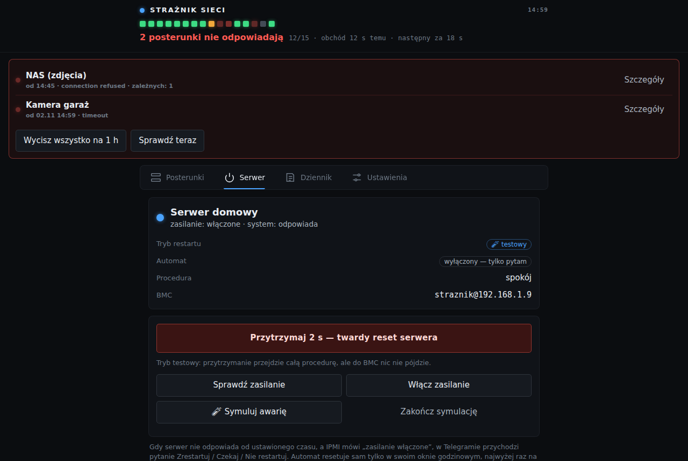

# 5. Awaryjny restart serwera przez IPMI (opcja, dla zaawansowanych)

**Ten rozdział dotyczy tylko serwerów z IPMI**, czyli osobnym układem do zdalnego
zarządzania (BMC). Mają go zwykle płyty serwerowe: Supermicro, Dell iDRAC, HP iLO,
Lenovo XCC, ASRock Rack. Zwykły komputer albo mini-PC (NUC) go nie ma. Jeśli Twój serwer
nie ma IPMI, pomiń ten rozdział.

> **Uwaga:** twardy reset działa jak przycisk RESET na obudowie. Wszystko, co działa na
> serwerze, natychmiast się wyłączy, bez zapisania danych. Dlatego strażnik domyślnie
> działa w **trybie testowym** i pyta o zgodę.



## Jak to działa

1. Strażnik uznaje serwer za **zawieszony**, gdy jednocześnie:
   - cel serwera nie odpowiada od **5 minut** (ustawialne),
   - **rodzic** serwera (np. router albo switch) odpowiada, więc sieć działa,
   - IPMI mówi, że **zasilanie jest włączone**, więc serwer nie został wyłączony.
2. Wtedy w Telegramie przychodzi pytanie z przyciskami **Zrestartuj / Czekaj 30 min /
   Nie restartuj**. Restart wymaga drugiego potwierdzenia.
3. Jeśli IPMI mówi, że zasilanie jest **wyłączone**, strażnik proponuje **Włącz**.
4. **Automat (domyślnie wyłączony):** gdy nikt nie odpowie przez 30 minut, strażnik sam
   zrobi reset. Bezpieczniki:
   - najwyżej jeden automatyczny reset na 2 godziny,
   - bez drugiej próby, jeśli serwer nie wstanie w 15 minut po resecie,
   - tylko w ustawionym oknie godzin (domyślnie 23:30–7:00, gdy nikt nie pracuje),
   - nigdy, gdy nie odpowiada rodzic serwera, bo wtedy winna jest sieć, nie serwer.

## Krok 1. Konto w IPMI tylko do zasilania

Załóż w BMC osobne konto z uprawnieniem **OPERATOR**. Takie konto może sterować
zasilaniem, ale nie zmieni haseł ani ustawień BMC. Nie dawaj strażnikowi konta
administratora.

Najprościej przez stronę WWW BMC (zakładka Users / Użytkownicy). Z linii poleceń na
serwerze (Linux, pakiet `ipmitool`), na przykładzie wolnego slotu 4:

```bash
ipmitool user set name 4 straznik
ipmitool user set password 4            # zapyta o hasło
ipmitool channel setaccess 1 4 callin=on ipmi=on link=on privilege=3   # 3 = OPERATOR
ipmitool user enable 4
ipmitool user list 1                    # sprawdź: straznik, OPERATOR
```

**Wymagania techniczne:** IPMI 2.0 po sieci (UDP 623) z pakietem szyfrowania 3 (HMAC-SHA1
+ AES-128). Tak działa większość BMC z ostatnich 10–15 lat. Strażnik był sprawdzany na
płycie Supermicro X9; na innych powinno działać, ale nie zostało przetestowane.

## Krok 2. Sprawdź połączenie z komputera (zalecane)

Zanim wpiszesz dane do strażnika, sprawdź je z komputera w tej samej sieci:

```bash
pip install cryptography
echo 'haslo-konta-straznik' > /tmp/ipmi-pw
python3 tools/ipmi_proto.py 192.168.1.9 straznik /tmp/ipmi-pw status
rm /tmp/ipmi-pw
```

Wynik w rodzaju `cc 0 power ON raw …` oznacza, że wszystko działa (`cc 0` = bez błędu). Błąd „RAKP2 … 0x0d” to zła nazwa użytkownika, „wrong password” to złe hasło. Ten skrypt to ten sam protokół, który
działa w strażniku. **Nie uruchamiaj go z `reset`**, bo naprawdę zresetuje serwer.

## Krok 3. Cel serwera na liście

Na liście celów (rozdział 3) musi być cel, który oznacza sam serwer, np.:

```json
{"id":"serwer","name":"Serwer domowy","type":"tcp","host":"192.168.1.10","port":22,"parent":"router"}
```

- Wybierz port, który odpowiada tylko wtedy, gdy **system** działa (SSH 22, Proxmox
  8006). Nie używaj ping, bo zawieszony system czasem dalej odpowiada na ping.
- Cel **musi mieć rodzica** (router albo switch, do którego serwer jest wpięty).
- Dobrze jest dodać też cel dla samego IPMI (`tcp`, port 443), żeby wiedzieć, że BMC
  odpowiada.

## Krok 4. Ustawienia w panelu

Panel → **Ustawienia → Restart serwera**:

| Pole | Znaczenie | Domyślnie |
|---|---|---|
| BMC (IPMI) adres | adres IP BMC | — |
| IPMI użytkownik / hasło | konto z kroku 1 | `straznik` / — |
| Cel = serwer (id) | `id` celu z kroku 3 | `serwer` |
| Pytaj po … min awarii | po ilu minutach niedziałania przyjdzie pytanie | 5 |
| Automat | automatyczny reset bez odpowiedzi | wyłączony |
| Reset po … min bez odpowiedzi | po ilu minutach bez Twojej odpowiedzi automat resetuje | 30 |
| Okno automatu od / do | godziny, w których automat może działać (równe = cała doba) | 23:30 / 07:00 |
| Tryb | **testowy**: cała procedura i wiadomości, ale reset nie idzie do BMC; **prawdziwy**: reset naprawdę idzie | testowy |

Zakładka **Serwer** pokaże wtedy stan zasilania odczytany z BMC.

## Krok 5. Przećwicz w trybie testowym

1. Zostaw **Tryb: testowy**.
2. Zakładka **Serwer → 🧪 Symuluj awarię** albo w Telegramie `/symuluj`. Strażnik
   udaje, że serwer nie odpowiada, i przechodzi całą procedurę na prawdziwym BMC (stan
   zasilania czyta naprawdę), ale **niczego nie resetuje**.
3. Po chwili w Telegramie przyjdzie pytanie z przyciskami. Kliknij **Zrestartuj** i
   potwierdź. Wiadomości będą oznaczone „🧪 SYMULACJA”.
4. Po „resecie” serwer „wraca” po minucie. Koniec symulacji: `/symuluj stop`.

Gdy wszystko wygląda dobrze, przełącz **Tryb: prawdziwy**. Panel zapyta o potwierdzenie.

## Ręczne sterowanie

- **Panel → Serwer:** przycisk resetu trzeba **przytrzymać 2 sekundy** (żeby nie
  kliknąć przypadkiem), „Włącz zasilanie”, odczyt stanu.
- **Telegram:** `/ipmi` (stan zasilania), `/restart` (reset z potwierdzeniem).

**Dalej:** [rozdział 6, codzienne używanie](06-codzienne-uzywanie.md).
